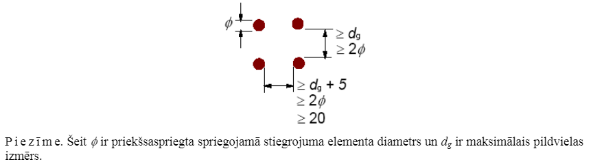
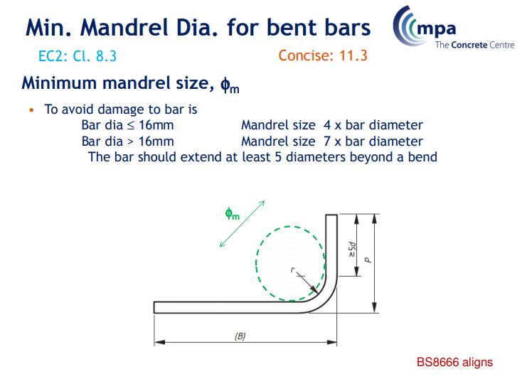
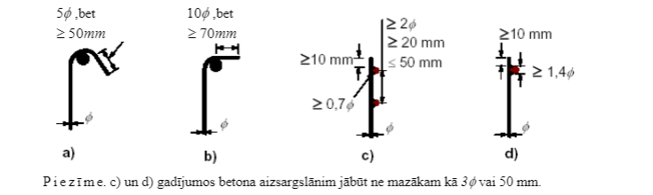

# Papildu prasības projektēšanai un izgatavošanai

Dzelzsbetona elementu dimensionēšanā jāņem vērā materiālu drošuma faktori un stiegrojuma izvietojuma konstruktīvie noteikumi.

---

## Materiālu parciālie koeficienti (\\(\gamma\\))

Nestspējas robežstāvokļa (ULS) pārbaudēm izmanto šādus materiālu parciālos koeficientus:

 | Projektā ievērtējamās situācijas | \\(\\gamma_c\\) (betonam) | \\(\\gamma_s\\) (stiegrojumam) | \\(\\gamma_{s,sp}\\) (spriegotajam stiegrojumam) | 
 | :--- | :---: | :---: | :---: | 
 | Ilgstošas un īslaicīgas | 1.50 | 1.15 | 1.15 | 
 | Ārkārtējas (avārijas, ugunsgrēka) | 1.20 | 1.00 | 1.00 | 
 | Seismiskās (zemestrīces) | 1.20 | 1.00 | 1.00 | 

*Piezīme: Ārkārtējās un seismiskajās situācijās betona un stiegrojuma koeficienti tiek samazināti līdz \\(\gamma_c = 1.20\\) un \\(\gamma_s = 1.00\\), kas atspoguļo zemāku nepieciešamo drošuma rezervi pret mazticamiem notikumiem.*

---

## Stiegrojuma enkurojuma un pārlaidumu garumi

Stiegrošanā jānodrošina pietiekams stieņu enkurojuma garums \\(l_{bd}\\) un pārlaiduma garums \\(l_0\\), lai spēki starp stieņiem un betonu tiktu nodoti bez sānslīdes.

**Enkurojuma un pārlaidumu garumi (mm) \\(\phi 8\\) līdz \\(\phi 40\\) stieņiem C25/30 klases betonam:**

  <table>
    <thead>
      <tr>
        <th rowspan="2" colspan="2">Garums</th>
        <th rowspan="2">Saķeres apstākļi</th>
        <th colspan="8">Stiepts stiegrojums, stieņa diametrs \(\phi\) (mm)</th>
        <th rowspan="2">Spiests stiegrojums</th>
      </tr>
      <tr>
        <th>8</th><th>10</th><th>12</th><th>16</th><th>20</th><th>25</th><th>32</th><th>40</th>
      </tr>
    </thead>
    <tbody>
      <tr>
        <td rowspan="4"><strong>Enkurojuma garums \(l_{bd}\)</strong></td>
        <td rowspan="2">Tikai taisni stieņi</td>
        <td>Labi</td>
        <td>230</td><td>320</td><td>410</td><td>600</td><td>780</td><td>1010</td><td>1300</td><td>1760</td><td>40\(\phi\)</td>
      </tr>
      <tr>
        <td>Slikti</td>
        <td>330</td><td>450</td><td>580</td><td>850</td><td>1120</td><td>1450</td><td>1850</td><td>2510</td><td>58\(\phi\)</td>
      </tr>
      <tr>
        <td rowspan="2">Citi stieņi (ar liekumiem, āķiem, cilpām)</td>
        <td>Labi</td>
        <td>320</td><td>410</td><td>490</td><td>650</td><td>810</td><td>1010</td><td>1300</td><td>1760</td><td>40\(\phi\)</td>
      </tr>
      <tr>
        <td>Slikti</td>
        <td>460</td><td>580</td><td>700</td><td>930</td><td>1160</td><td>1450</td><td>1850</td><td>2510</td><td>58\(\phi\)</td>
      </tr>
      <tr>
        <td rowspan="4"><strong>Pārlaiduma garums \(l_0\)</strong></td>
        <td rowspan="2">50 % stieņu savienoti vienā šķērsgriezumā (\(\alpha_6 = 1.4\))</td>
        <td>Labi</td>
        <td>320</td><td>440</td><td>570</td><td>830</td><td>1090</td><td>1420</td><td>1810</td><td>2460</td><td>57\(\phi\)</td>
      </tr>
      <tr>
        <td>Slikti</td>
        <td>460</td><td>630</td><td>820</td><td>1190</td><td>1560</td><td>2020</td><td>2590</td><td>3520</td><td>81\(\phi\)</td>
      </tr>
      <tr>
        <td rowspan="2">100 % stieņu savienoti vienā šķērsgriezumā (\(\alpha_6 = 1.5\))</td>
        <td>Labi</td>
        <td>340</td><td>470</td><td>610</td><td>890</td><td>1170</td><td>1520</td><td>1940</td><td>2640</td><td>61\(\phi\)</td>
      </tr>
      <tr>
        <td>Slikti</td>
        <td>490</td><td>680</td><td>870</td><td>1270</td><td>1670</td><td>2170</td><td>2770</td><td>3770</td><td>87\(\phi\)</td>
      </tr>
    </tbody>
  </table>

*Avots: The Concrete Centre, „How to design concrete structures using Eurocode 2: Detailing”; tulkots un pārveidots.*

**Piezīmes par tabulu:**

1. Nominālais aizsargslānis no visām pusēm \\(\ge 25\\) mm (t.i., \\(\alpha_2 \le 1\\)). Pārlaidumos tīrais attālums starp stieņiem \\(\le 50\\) mm.
2. \\(\alpha_1 = \alpha_3 = \alpha_4 = \alpha_5 = 1.0\\). Stieņa formas, aizsargslāņa un sasaistes labvēlīgo ietekmi skat. LVS EN 1992-1-1 8.2. tabulā.
3. Pieņemts aprēķina spriegums stienī 435 MPa. Ja stieņa aprēķina spriegums \\(\sigma_{sd}\\) vietā, no kuras mēra enkurojumu, ir mazāks par 435 MPa, tabulas vērtības var reizināt ar \\(\sigma_{sd}/435\\). Minimālais pārlaiduma garums dots LVS EN 1992-1-1 8.7.3. punktā.
4. Enkurojuma un pārlaidumu garumi noapaļoti uz augšu līdz tuvākajiem 10 mm.
5. Ja vienā šķērsgriezumā savienoti 33 % stieņu, rindas „50 % stieņu savienoti” pārlaidumu garumus reizina ar 0.82.
6. Saķeres apstākļi (labi / slikti) — saskaņā ar LVS EN 1992-1-1 8.2. attēlu.

**Citu stiprības klašu betoniem** tabulas vērtības reizina ar pārrēķina koeficientu:

| Betona klase | C20/25 | C28/35 | C30/37 | C32/40 | C35/45 | C40/50 | C45/55 | C50/60 |
| :--- | :---: | :---: | :---: | :---: | :---: | :---: | :---: | :---: |
| Koeficients | 1.16 | 0.93 | 0.89 | 0.85 | 0.80 | 0.73 | 0.68 | 0.63 |

---

## Attālumi starp stieņiem

### 1. Minimālais attālums starp stiegrām (LVS EN 1992-1-1 8.2. punkts)
Tīrais attālums (horizontālais un vertikālais) starp atsevišķām paralēlām stiegrām vai paralēlu stiegru kārtām nedrīkst būt mazāks par lielāko no šiem trim lielumiem:
- \\(k_1 \cdot \phi\\) (stiegrojuma stieņa diametrs);
- \\(d_g + k_2 mm\\) (pildvielas maksimālais izmērs);
- \\(20 mm\\).

*Latvijas nacionālajā pielikumā noteiktās vērtības ir \\(k_1 = 1\\) un \\(k_2 = 5 mm\\). Tas nozīmē, ka pie maksimālās pildvielas frakcijas \\(16 mm\\) minimālais tīrais attālums ir \\(21 mm\\) vai stieņa diametrs \\(\phi\\).*

### 2. Minimālais attālums starp priekšspriegotā stiegrojuma elementiem (LVS EN 1992-1-1 8.10.1.2. punkts)
Minimālajiem tīrajiem horizontālajiem un vertikālajiem attālumiem starp priekšspriegotā stiegrojuma elementiem (trosēm, kanāliem) jāatbilst attēla shēmai, kur \\(\phi\\) ir elementa diametrs un \\(d_g\\) ir maksimālais pildvielas izmērs.

---

## Maksimālais attālums starp stiegrām (aptveru solis)

Maksimālais attālums starp kolonnu šķērsstiegrojuma stiegrām (aptveru solis) \\(s_{cl,tmax}\\) nedrīkst pārsniegt mazāko no šādiem lielumiem:
- \\(20 \cdot \phi_{min}\\) (kur \\(\phi_{min}\\) ir garenstiegrojuma minimālais diametrs);
- kolonnas mazākais šķērsgriezuma izmērs (platums vai augstums);
- \\(400 mm\\).

*Piezīme: Šķērsstiegrojuma solis jāsamazina par koeficientu \\(0.6\\) (t.i., \\(0.6 \cdot s_{cl,tmax}\\)) zonās virs un zem sijām viena stāva augstumā, kā arī stieņu pārlaidumu zonās, ja garenstieņu diametrs \\(\phi > 14 mm\\).*

---

## Minimālais stiegru liekuma rādiuss

Stieņu liekšana (piemēram, cilpu, āķu vai stūra stieņu izveidei) jāveic ar pietiekamu liekuma rādiusu (liekšanas rullīša diametru \\(\phi\\)), lai novērstu stieņa bojājumus liekšanas procesā un betona sašķelšanos liekuma iekšpusē.

### Aptveru un šķērsspēku uzņemošā stiegrojuma enkurojums:

---

## Betona virsmu klasifikācija (darba šuvēm)

Aprēķinot bīdes spēku pārnesi pa betona darba šuvēm (saskaņā ar LVS EN 1992-1-1 6.2.5. punktu), šuves virsmas klasificē četrās kategorijās. Katrai kategorijai atbilst kohēzijas koeficients \\(c\\) un berzes koeficients \\(\mu\\):

- **Ļoti gluda (\\(c = 0.025 ... 0.10\\); \\(\mu = 0.5\\)):** Virsma, kas betonēta pret tērauda, plastmasas vai speciāli sagatavotiem koka veidņiem.
- **Gluda (\\(c = 0.20\\); \\(\mu = 0.6\\)):** Ar slīdošajiem veidņiem betonēta, ekstrudēta vai brīva virsma, kas pēc vibrēšanas atstāta bez tālākas apstrādes.
- **Nelīdzena (\\(c = 0.40\\); \\(\mu = 0.7\\)):** Virsma ar vismaz 3 mm dziļiem nelīdzenumiem, kas izvietoti ik pēc aptuveni 40 mm, vai virsma ar atsegtām pildvielas daļiņām.
- **Robota (\\(c = 0.50\\); \\(\mu = 0.9\\)):** Speciāli veidota rievota vai zobota virsma saskaņā ar standarta 6.9. attēlu.
