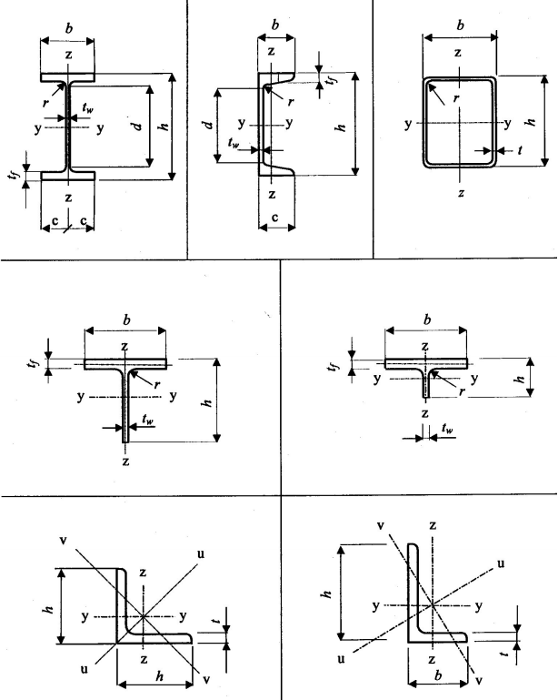
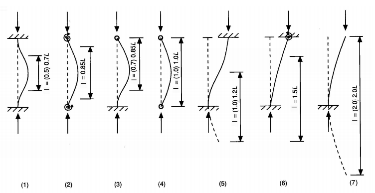

# Šķērsgriezumu un elementu aprēķins (ULS)

Tērauda elementu nestspējas un stabilitātes pārbaudes tiek veiktas saskaņā ar LVS EN 1993-1-1.

---

## Materiāla parciālie drošības koeficienti (\\(\gamma_M\\))

Aprēķinot elementu un savienojumu pretestību nestspējas robežstāvoklī (ULS), tērauda stiprību dala ar materiāla parciālajiem koeficientiem \\(\gamma_M\\). 

**Latvijā piemērojamie koeficienti saskaņā ar LVS EN 1993-1-1/NA:**

| Elementi / Pārbaudes | Pretestības raksturojums | Drošības koeficients \\(\gamma_M\\) |
| :--- | :--- | :---: |
| Elementu un šķērsgriezumu pretestība: | | |
| — Šķērsgriezuma nestspēja (visām klasēm) | Pretestība šķērsgriezuma plastiskai plūstamībai, ieskaitot sāniskās vērpes klupšanu | \\(\gamma_{M0} = 1.00\\) |
| — Elementu stabilitāte (noturības pārbaudes) | Stieņu pretestība izlieces un vērpes klupšanai stieņu pārbaudēs | **\\(\gamma_{M1} = 1.00\\)** * |
| — Stieptu šķērsgriezumu sabrukums | Pretestība trauslam sabrukumam stieptos šķēlumos pie skrūvju caurumiem | \\(\gamma_{M2} = 1.25\\) |
| Savienojumu pretestība: | | |
| — Skrūvju un metinātie savienojumi | Pretestība skrūvēm, kniedēm, tapām un metinātajām šuvēm | \\(\gamma_{M2} = 1.25\\) |
| — Virsmu berzes pretestība (berzes šuvēm) | Pretestība slīdei (normāliem skrūvju caurumiem):   — nestspējas robežstāvoklī (ULS)   — lietojamības robežstāvoklī (SLS) |  \\(\gamma_{M3} = 1.25\\)  \\(\gamma_{M3,ser} = 1.10\\) |
| — Injekcijas skrūvju savienojumi | Pretestība injekcijas skrūvēm | \\(\gamma_{M4} = 1.10\\) |
| — Slēgto profilu (cauruļprofilu) savienojumi | Režģoto kopņu mezglu nestspēja | \\(\gamma_{M5} = 1.10\\) |
| — Kniedētie savienojumi | Kniedēto savienojumu pārbaude SLS | \\(\gamma_{M6,ser} = 1.00\\) |
| — Augstas stiprības skrūvju iepriekšējais saspriegums | Skrūvju spriegošanas spēka pārbaude | \\(\gamma_{M7} = 1.10\\) |

*\*Svarīga piezīme: LVS EN 1993-1-1/NA nosaka stabilitātes koeficientu **\\(\gamma_{M1} = 1.00\\)** (Eirokodeksa pamatdokumentā rekomendētā vērtība ir \\(1.10\\)). Tas nodrošina ekonomiskāku tērauda elementu stabilitātes aprēķinu Latvijas teritorijā.*

---

## Elementu asu izkārtojums un aprēķina garumi

Tērauda elementu šķērsgriezuma koordinātu asis tiek definētas šādi:
- **X-X:** Elementa garenass;
- **Y-Y:** Stiprā ass (liece pret šo asi rada lieces momentu \\(M_y\\), kur šķērsgriezuma elastības pretestības modulis \\(W_y\\) ir maksimālais);
- **Z-Z:** Vājā ass (pretestības modulis \\(W_z\\) ir minimālais).

| Koordinātu asu izvietojums | Aprēķina garumi \\(L_{\text{cr}}\\) tipiskām atbalsta situācijām |
| :---: | :---: |
|  |  |

---

## Provizoriskās laidumu un augstumu attiecības (\\(L/d\\))

Konstruēšanas sākumposmā elementu šķērsgriezuma augstumu (dziļumu) \\(d\\) var provizoriski noteikt pēc laiduma un augstuma attiecības \\(L/d\\):

  <table>
    <thead>
      <tr>
        <th rowspan="2">Elements</th>
        <th rowspan="2">Attiecība \(L/d\)</th>
        <th colspan="10">Provizoriskais augstums \(d\) (mm) atkarībā no laiduma (\(L\), m)</th>
      </tr>
      <tr>
        <th>3 m</th>
        <th>4.5 m</th>
        <th>6 m</th>
        <th>7.5 m</th>
        <th>9 m</th>
        <th>12 m</th>
        <th>15 m</th>
        <th>23 m</th>
        <th>30 m</th>
        <th>45-90 m</th>
      </tr>
    </thead>
    <tbody>
      <tr>
        <td>Sija (vispārīga)</td>
        <td><strong>20</strong></td>
        <td>230</td><td>300</td><td>390</td><td>460</td><td>610</td><td>770</td><td>1150</td><td>—</td><td>—</td><td>—</td>
      </tr>
      <tr>
        <td>Kompozītā sija</td>
        <td><strong>28</strong></td>
        <td>200</td><td>220</td><td>270</td><td>320</td><td>440</td><td>550</td><td>820</td><td>—</td><td>—</td><td>—</td>
      </tr>
      <tr>
        <td>Rāmja sija (stinga)</td>
        <td><strong>10</strong></td>
        <td>460</td><td>610</td><td>760</td><td>900</td><td>1100</td><td>1500</td><td>2300</td><td>—</td><td>—</td><td>—</td>
      </tr>
      <tr>
        <td>Grīdas sek. sijas</td>
        <td><strong>20</strong></td>
        <td>150</td><td>230</td><td>300</td><td>400</td><td>450</td><td>600</td><td>750</td><td>—</td><td>—</td><td>—</td>
      </tr>
      <tr>
        <td>Jumta sek. sijas</td>
        <td><strong>24</strong></td>
        <td>—</td><td>—</td><td>—</td><td>—</td><td>—</td><td>640</td><td>800</td><td>950</td><td>1250</td><td>—</td>
      </tr>
      <tr>
        <td>Metināta sija</td>
        <td><strong>15</strong></td>
        <td>—</td><td>400</td><td>500</td><td>600</td><td>800</td><td>1000</td><td>1500</td><td>2000</td><td>—</td><td>—</td>
      </tr>
      <tr>
        <td>Kopne</td>
        <td><strong>12</strong></td>
        <td>—</td><td>500</td><td>640</td><td>760</td><td>1000</td><td>1300</td><td>1900</td><td>2500</td><td>3000</td><td>5000-7000</td>
      </tr>
      <tr>
        <td>Telpisks režģis</td>
        <td><strong>16</strong></td>
        <td>—</td><td>—</td><td>—</td><td>570</td><td>760</td><td>950</td><td>1400</td><td>1900</td><td>2860</td><td>3800-5700</td>
      </tr>
    </tbody>
  </table>

*Piezīme: Šī tabula paredzēta tikai provizoriskam izmēru novērtējumam. Galīgais šķērsgriezums vienmēr jānosaka ar stiprības, stabilitātes un izlieces aprēķiniem.*

---

## Paralēlo joslu kopņu projektēšanas nosacījumi

Saskaņā ar cauruļveida profilu (RHS) kopņu projektēšanas rokasgrāmatām, optimālā laiduma un augstuma attiecība paralēlo joslu kopnēm ir robežās no **\\(10\\) līdz \\(15\\)** (optimāli tuvu **\\(15\\)**).

Kopņu pašsvarā lielāko daļu sastāda joslas (ap 50% spiestā josla, 30% stieptā josla), bet režģa elementi (atgāžņi un statņi) sastāda tikai ap 20%. Tādēļ kopņu projektēšanā jāievēro šāda labā prakse:
- izvēlēties konstantu režģa paneļu platumu visā kopnes garumā, lai standartizētu mezglus;
- paredzēt pāra skaitu režģa elementu (atgāžņu);
- noslogotākos režģa elementus (it īpaši pie balstiem) orientēt tā, lai tie darbotos **stiepē** (stiepti stieņi nav pakļauti klupšanai, kas ļauj izmantot mazākus šķērsgriezumus);
- atgāžņu slīpuma leņķi pret joslām veidot robežās no **\\(35^\circ\\) līdz \\(50^\circ\\)**;
- sekundārās slodzes (kopturus) izvietot tieši kopnes mezglos, lai novērstu joslu lokālo lieci.

**Kopņu laiduma pret augstumu (\\(L/D\\)) attiecības:**

| Konstrukciju veids | Attiecība \\(L/D\\) | Piezīmes |
| :--- | :---: | :--- |
| Velmētie tērauda profili (sijas) | \\(< 20\\) | Lieces un izlieces kritēriji. |
| Vienlaiduma kopnes:   — smagai slodzei   — vidējai slodzei   — vieglai slodzei (jumti) |  \\(12 \dots 15\\)  \\(15 \dots 18\\)  \\(18 \dots 21\\) | Var izmantot lielākas attiecības robežas, ja mezglos tiek nodrošināti stingri (momentizturīgi) savienojumi. |
| Telpiskie režģi un plātnes | \\(15 \dots 45\\) | Balstās uz skrūvējamiem un metinātiem mezgliem. |

<svg class="chart-fig" viewBox="0 0 640 372" width="640" role="img" aria-label="Kopnes augstums D atkarībā no laiduma l"><line class="ch-grid" x1="60.0" y1="20" x2="60.0" y2="330"/><text class="ch-tick" x="60.0" y="346" text-anchor="middle">0</text><line class="ch-grid" x1="130.0" y1="20" x2="130.0" y2="330"/><line class="ch-grid" x1="200.0" y1="20" x2="200.0" y2="330"/><text class="ch-tick" x="200.0" y="346" text-anchor="middle">10</text><line class="ch-grid" x1="270.0" y1="20" x2="270.0" y2="330"/><line class="ch-grid" x1="340.0" y1="20" x2="340.0" y2="330"/><text class="ch-tick" x="340.0" y="346" text-anchor="middle">20</text><line class="ch-grid" x1="410.0" y1="20" x2="410.0" y2="330"/><line class="ch-grid" x1="480.0" y1="20" x2="480.0" y2="330"/><text class="ch-tick" x="480.0" y="346" text-anchor="middle">30</text><line class="ch-grid" x1="550.0" y1="20" x2="550.0" y2="330"/><line class="ch-grid" x1="620.0" y1="20" x2="620.0" y2="330"/><text class="ch-tick" x="620.0" y="346" text-anchor="middle">40</text><line class="ch-grid" x1="60" y1="330.0" x2="620" y2="330.0"/><text class="ch-tick" x="52" y="334.0" text-anchor="end">0</text><line class="ch-grid" x1="60" y1="278.3" x2="620" y2="278.3"/><text class="ch-tick" x="52" y="282.3" text-anchor="end">1</text><line class="ch-grid" x1="60" y1="226.7" x2="620" y2="226.7"/><text class="ch-tick" x="52" y="230.7" text-anchor="end">2</text><line class="ch-grid" x1="60" y1="175.0" x2="620" y2="175.0"/><text class="ch-tick" x="52" y="179.0" text-anchor="end">3</text><line class="ch-grid" x1="60" y1="123.3" x2="620" y2="123.3"/><text class="ch-tick" x="52" y="127.3" text-anchor="end">4</text><line class="ch-grid" x1="60" y1="71.7" x2="620" y2="71.7"/><text class="ch-tick" x="52" y="75.7" text-anchor="end">5</text><line class="ch-grid" x1="60" y1="20.0" x2="620" y2="20.0"/><text class="ch-tick" x="52" y="24.0" text-anchor="end">6</text><rect class="ch-frame" x="60" y="20" width="560" height="310"/><polygon class="ch-band" points="144.0,289.2 151.0,285.9 158.0,282.7 165.0,279.4 172.0,276.2 179.0,272.9 186.0,269.7 193.0,266.5 200.0,263.3 207.0,260.1 214.0,256.9 221.0,253.7 228.0,250.5 235.0,247.3 242.0,244.1 249.0,240.9 256.0,237.8 263.0,234.6 270.0,231.4 277.0,228.3 284.0,225.2 291.0,222.0 298.0,218.9 305.0,215.8 312.0,212.6 319.0,209.5 326.0,206.4 333.0,203.3 340.0,200.2 347.0,197.1 354.0,194.0 361.0,191.0 368.0,187.9 375.0,184.8 382.0,181.8 389.0,178.7 396.0,175.6 403.0,172.6 410.0,169.6 417.0,166.5 424.0,163.5 431.0,160.5 438.0,157.5 445.0,154.5 452.0,151.5 459.0,148.5 466.0,145.5 473.0,142.5 480.0,139.5 487.0,136.5 494.0,133.6 501.0,130.6 508.0,127.7 515.0,124.7 522.0,121.8 529.0,118.8 536.0,115.9 543.0,113.0 550.0,110.1 557.0,107.1 564.0,104.2 571.0,101.3 578.0,98.4 585.0,95.6 592.0,92.7 599.0,89.8 606.0,86.9 613.0,84.1 620.0,81.2 620.0,160.1 613.0,162.3 606.0,164.6 599.0,166.8 592.0,169.0 585.0,171.3 578.0,173.5 571.0,175.7 564.0,177.9 557.0,180.1 550.0,182.3 543.0,184.5 536.0,186.7 529.0,188.9 522.0,191.1 515.0,193.3 508.0,195.5 501.0,197.6 494.0,199.8 487.0,202.0 480.0,204.2 473.0,206.3 466.0,208.5 459.0,210.6 452.0,212.8 445.0,214.9 438.0,217.1 431.0,219.2 424.0,221.4 417.0,223.5 410.0,225.6 403.0,227.7 396.0,229.9 389.0,232.0 382.0,234.1 375.0,236.2 368.0,238.3 361.0,240.4 354.0,242.5 347.0,244.6 340.0,246.7 333.0,248.8 326.0,250.8 319.0,252.9 312.0,255.0 305.0,257.1 298.0,259.1 291.0,261.2 284.0,263.2 277.0,265.3 270.0,267.4 263.0,269.4 256.0,271.4 249.0,273.5 242.0,275.5 235.0,277.5 228.0,279.6 221.0,281.6 214.0,283.6 207.0,285.6 200.0,287.6 193.0,289.7 186.0,291.7 179.0,293.7 172.0,295.7 165.0,297.6 158.0,299.6 151.0,301.6 144.0,303.6"/><line class="ch-ref" x1="144.0" y1="291.2" x2="620.0" y2="71.7"/><text class="ch-label" x="616.0" y="65.7" text-anchor="end">l/D = 8</text><line class="ch-ref" x1="144.0" y1="304.2" x2="620.0" y2="157.8"/><text class="ch-label" x="616.0" y="171.8" text-anchor="end">l/D = 12</text><text class="ch-label" transform="translate(382.0 171.8) rotate(-28)" text-anchor="middle">liels w*/l</text><text class="ch-label" transform="translate(452.0 232.8) rotate(-28)" text-anchor="middle">mazs w*/l</text><rect class="ch-inset-bg" x="78" y="26" width="276" height="96"/><rect class="ch-inset" x="90" y="42" width="220" height="10"/><line class="ch-inset-thin" x1="103.8" y1="42" x2="103.8" y2="52"/><line class="ch-inset-thin" x1="117.5" y1="42" x2="117.5" y2="52"/><line class="ch-inset-thin" x1="131.2" y1="42" x2="131.2" y2="52"/><line class="ch-inset-thin" x1="145.0" y1="42" x2="145.0" y2="52"/><line class="ch-inset-thin" x1="158.8" y1="42" x2="158.8" y2="52"/><line class="ch-inset-thin" x1="172.5" y1="42" x2="172.5" y2="52"/><line class="ch-inset-thin" x1="186.2" y1="42" x2="186.2" y2="52"/><line class="ch-inset-thin" x1="200.0" y1="42" x2="200.0" y2="52"/><line class="ch-inset-thin" x1="213.8" y1="42" x2="213.8" y2="52"/><line class="ch-inset-thin" x1="227.5" y1="42" x2="227.5" y2="52"/><line class="ch-inset-thin" x1="241.2" y1="42" x2="241.2" y2="52"/><line class="ch-inset-thin" x1="255.0" y1="42" x2="255.0" y2="52"/><line class="ch-inset-thin" x1="268.8" y1="42" x2="268.8" y2="52"/><line class="ch-inset-thin" x1="282.5" y1="42" x2="282.5" y2="52"/><line class="ch-inset-thin" x1="296.2" y1="42" x2="296.2" y2="52"/><text class="ch-label" x="200.0" y="38" text-anchor="middle" font-style="italic">w*</text><polyline class="ch-inset" points="90,78 200.0,64 310,78"/><line class="ch-inset" x1="90" y1="86" x2="310" y2="86"/><line class="ch-inset" x1="90" y1="78" x2="90" y2="86"/><line class="ch-inset" x1="310" y1="78" x2="310" y2="86"/><line class="ch-inset-thin" x1="117.5" y1="74.5" x2="117.5" y2="86"/><line class="ch-inset-thin" x1="117.5" y1="74.5" x2="90.0" y2="86"/><line class="ch-inset-thin" x1="145.0" y1="71.0" x2="145.0" y2="86"/><line class="ch-inset-thin" x1="145.0" y1="71.0" x2="117.5" y2="86"/><line class="ch-inset-thin" x1="172.5" y1="67.5" x2="172.5" y2="86"/><line class="ch-inset-thin" x1="172.5" y1="67.5" x2="145.0" y2="86"/><line class="ch-inset-thin" x1="200.0" y1="64.0" x2="200.0" y2="86"/><line class="ch-inset-thin" x1="200.0" y1="64.0" x2="172.5" y2="86"/><line class="ch-inset-thin" x1="227.5" y1="67.5" x2="227.5" y2="86"/><line class="ch-inset-thin" x1="227.5" y1="67.5" x2="255.0" y2="86"/><line class="ch-inset-thin" x1="255.0" y1="71.0" x2="255.0" y2="86"/><line class="ch-inset-thin" x1="255.0" y1="71.0" x2="282.5" y2="86"/><line class="ch-inset-thin" x1="282.5" y1="74.5" x2="282.5" y2="86"/><line class="ch-inset-thin" x1="282.5" y1="74.5" x2="310.0" y2="86"/><line class="ch-inset-thin" x1="318" y1="64" x2="318" y2="86"/><text class="ch-label" x="323" y="79.0" font-style="italic">D</text><line class="ch-inset-thin" x1="90" y1="96" x2="310" y2="96"/><text class="ch-label" x="200.0" y="110" text-anchor="middle" font-style="italic">l</text><text class="ch-axis" x="340.0" y="366" text-anchor="middle">Laidums l, m</text><text class="ch-axis" transform="translate(18 175.0) rotate(-90)" text-anchor="middle">Augstums D, m</text></svg>

*Kopnes augstuma \\(D\\) orientējošā josla atkarībā no laiduma \\(l\\): augšējā robeža — lielai slodzei uz laiduma vienību (\\(w^\ast/l\\)), apakšējā — mazai. Josla atbilst aptuveni \\(l/D \approx 8 \dots 12\\).*
