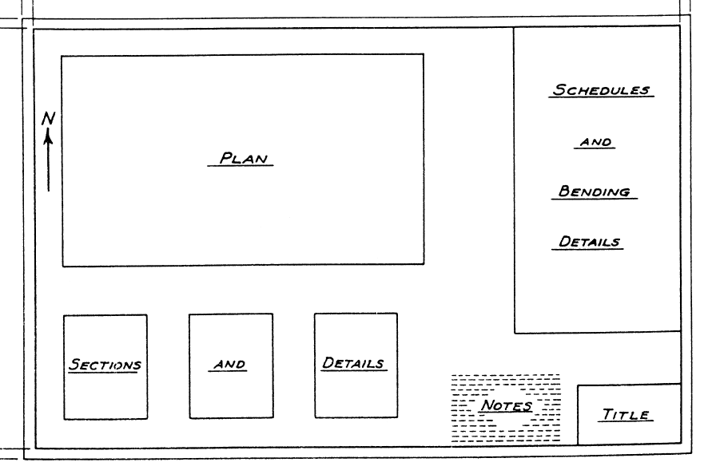
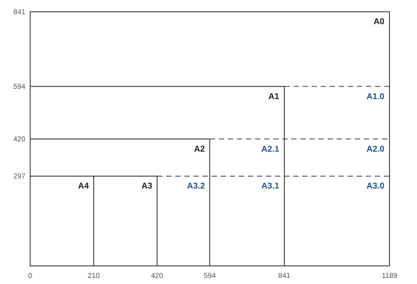

# Rasējuma lapu izkārtojums un formāti

Rasējumu lapas noformē un loka saskaņā ar standartu **LVS EN ISO 5457** (tehniskā produkta dokumentācija — rasējumu lapu izmēri un izkārtojums).

---

## Optimālais rasējuma lapas izkārtojums

Parasti rasējuma laukumu sadala šādās zonās:
- **Kreisajā un centrālajā daļā:** Rasējuma grafiskā daļa (plāni, griezumi, fasādes);
- **Apakšējā daļā:** Mezgli, detaļas un papildu griezumi;
- **Labajā malā (virs rakstlaukuma):** Elementu specifikācijas (tabulas) un teksta piezīmes (norādes par materiāliem, slodzēm, izbūvi).

> [!TIP]
> Specifikāciju un piezīmju bloku platumu ieteicams veidot tieši **\\(185\text{ mm}\\)** platumā (atbilstoši standarta rakstlaukuma platumam). Salokot lapu A4 formātā, specifikācijas un piezīmes būs uzreiz redzamas uz pirmās salocītās lapas virsmas, tās pilnībā neatlokot. Tas novērš arī svarīgas informācijas kropļošanu locījumu vietās.

---

## Standarta rasējumu lapu izmēri (ISO 216, LVS EN ISO 5457)

Rasējumu izstrādē izmanto A sērijas lapu formātus. Izmēri doti milimetros kā īsākā × garākā mala (\\(a \times b\\)):

| Formāts | Apdarinātais formāts \\(a_1 \times b_1\\) | Rasējamais laukums \\(a_2 \times b_2\\) | Neapdarinātais formāts \\(a_3 \times b_3\\) | Piezīmes |
| :---: | :---: | :---: | :---: | :--- |
| **A0** | 841 × 1189 | 821 × 1159 | 880 × 1230 | Lielformāta plāniem un kopsalikumiem. |
| **A1** | 594 × 841 | 574 × 811 | 625 × 880 | Standarta izmērs būvkonstrukciju plāniem. |
| **A2** | 420 × 594 | 400 × 564 | 450 × 625 | Izdevīgs mezglu lapām un mazākiem plāniem. |
| **A3** | 297 × 420 | 277 × 390 | 330 × 450 | Ļoti ērts montāžas un mezglu shēmām (viegli pārnēsājams būvlaukumā). |
| **A4** | 210 × 297 | 180 × 277 | 240 × 330 | Tikai specifikācijām, titullapām vai vienkāršām detaļām. |

Formātam A4 ir paredzēts **tikai vertikāls** lapas novietojums, pārējiem formātiem — **tikai horizontāls**. Salokot lapas uzglabāšanai, rakstlaukumam ar projekta nosaukumu un numuru vienmēr jāatrodas priekšpusē.

### Papildformāti

Pamatformātus var pagarināt atbilstoši shēmai un iegūt sešus papildformātus:

| Papildformāts | A1.0 | A2.1 | A2.0 | A3.2 | A3.1 | A3.0 |
| :--- | :---: | :---: | :---: | :---: | :---: | :---: |
| Izmēri \\(a \times b\\) (mm) | 594 × 1189 | 420 × 841 | 420 × 1189 | 297 × 594 | 297 × 841 | 297 × 1189 |
